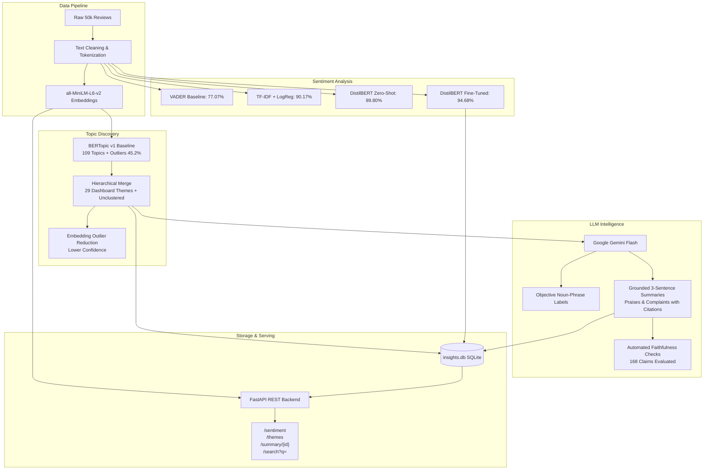

# Nexus — Review Insights

[](https://www.python.org/downloads/release/python-3119/)
[](https://fastapi.tiangolo.com)
[](https://maartengr.github.io/BERTopic/)
[](https://pytorch.org)
[]()

**Nexus** is an enterprise-grade customer review intelligence engine built on **50,000 Amazon product reviews**. It provides an end-to-end analytical pipeline: transformer-based sentiment classification, outlier-aware topic discovery and reduction to **29 core themes**, hallucination-guarded LLM grounded summaries, sub-10ms semantic vector search, relational SQLite storage, and a production-ready FastAPI REST service.

---

## Architecture Overview



---

## Key Capabilities

1. **State-of-the-Art Sentiment Classification**: Fine-tuned DistilBERT achieving **94.68% accuracy** and **0.9468 Macro F1** on the 10,000-review test split, substantially outperforming heuristic (VADER: 77.07%) and linear (TF-IDF: 90.17%) baselines.
2. **Outlier-Aware Topic Modeling (29 Themes)**: Discovers granular topics via BERTopic (`all-MiniLM-L6-v2` + HDBSCAN), hierarchically merged into **29 dashboard-sized themes** plus an explicit `"Unclustered"` outlier baseline (`-1`). An embedding-based outlier reassignment model (`topics_v1_reduced.parquet`) is maintained separately for optional lower-confidence exploration.
3. **Grounded LLM Summaries with Faithfulness Guardrails**: Prompts Gemini for 3-sentence executive summaries, up to 3 praises, and up to 3 complaints with bracketed review citations. Automated validation enforces:
   - Verification that every cited ID exists in the stratified sample.
   - Citation requirement on every praise and complaint claim.
   - Non-empty content-word overlap between claim assertions and cited review text.
4. **Sub-10ms Semantic Vector Search**: Embeds incoming queries via `all-MiniLM-L6-v2` loaded once at application startup, performing dot-product cosine similarity across 50,000 pre-normalized embeddings to return top-10 ranked reviews.
5. **Robust Relational Storage (`insights.db`)**: SQLite schema indexing `reviews(topic_id)` and `reviews(review_id)`, with metadata tables for theme stats and JSON-structured grounded summaries.

---

## Benchmark Results

### 1. Sentiment Classification Comparison (10,000 Test Reviews)

| Model | Accuracy | Macro F1 | True Negative | False Positive | False Negative | True Positive |
|:---|:---:|:---:|:---:|:---:|:---:|:---:|
| **VADER (Default)** | 0.7189 | 0.7041 | 2,477 | 2,457 | 354 | 4,712 |
| **VADER (Tuned $\theta=0.7$)** | 0.7707 | 0.7706 | 3,727 | 1,207 | 1,086 | 3,980 |
| **TF-IDF + Logistic Regression** | 0.9017 | 0.9017 | 4,426 | 508 | 475 | 4,591 |
| **DistilBERT (Zero-Shot)** | 0.8980 | 0.8980 | 4,506 | 428 | 592 | 4,474 |
| **DistilBERT (Fine-Tuned)** | **0.9468** | **0.9468** | **4,661** | **273** | **259** | **4,807** |

### 2. Topic Modeling Coherence (NPMI)

| Method | Topic Count | Outlier % | NPMI Coherence |
|:---|:---:|:---:|:---:|
| **LDA ($k=10$)** | 10 | 0.0% | 0.0420 |
| **LDA ($k=15$)** | 15 | 0.0% | 0.0305 |
| **BERTopic v1 (Baseline)** | 109 | 45.2% | **0.0983** |
| **BERTopic v2 (Loose)** | 248 | 46.7% | 0.0593 |
| **BERTopic v1 (Merged 29 Themes)** | 29 | 45.2% | 0.0401 |

> **Methodological Note on Coherence**: *Coherence depends on topic count and outlier handling; BERTopic NPMI is computed on clustered topics only, excluding the outlier group.*

### 3. Top 5 Themes with Highest Negative Sentiment

Query executed on `data/processed/insights.db` (excluding `Unclustered` and themes with $<100$ reviews):

```sql
SELECT topic_id, label, count, pct_negative
FROM themes
WHERE topic_id != -1 AND count >= 100
ORDER BY pct_negative DESC
LIMIT 5;
```

| Topic ID | Theme Label | Total Reviews | Negative % |
|:---:|:---|:---:|:---:|
| **17** | Cables and TV accessories | 209 | **69.38%** |
| **18** | Baby bottles and diapers | 209 | **68.90%** |
| **9** | Computer hardware and storage | 504 | **68.45%** |
| **7** | Batteries and chargers | 772 | **63.08%** |
| **8** | Headphones and phones | 565 | **61.95%** |

### 4. Faithfulness Verification Statistics

Automated verification was executed across all 29 themes:
- **Praise & Complaint Claims Evaluated**: 168
- **Overview Summaries**: 29 (treated as *uncited-by-design* and tracked separately)
- **Claims Skipped for Word Overlap**: 6 (Theme 24: Spanish-language reviews)
- **Hallucinated Citations Dropped**: 1 (Review ID `2706` in Theme 2 was an out-of-sample citation)
- **Flagged Claims**: 2 (word-overlap false alarms in Theme 14 and Theme 28)

---

## 29 Final Product Themes

| ID | Theme Label | ID | Theme Label |
|:---:|:---|:---:|:---|
| **-1** | Unclustered *(Outlier group)* | **14** | Exercise and dance DVDs |
| **0** | Books | **15** | Cameras and lenses |
| **1** | Movies and DVDs | **16** | Watches and jewelry |
| **2** | Music CDs and albums | **17** | Cables and TV accessories |
| **3** | Toys and gifts | **18** | Baby bottles and diapers |
| **4** | Coffee makers | **19** | Bedding and pillows |
| **5** | Supplements, food and personal care | **20** | Mixed: Gun cases and backpacks |
| **6** | Video games | **21** | Keyboards and mice |
| **7** | Batteries and chargers | **22** | Lights and LED headlamps |
| **8** | Headphones and phones | **23** | Magazine subscriptions |
| **9** | Computer hardware and storage | **24** | Spanish-language reviews |
| **10** | Dog training products | **25** | Baby car seats |
| **11** | Knives and cutting tools | **26** | GPS navigation devices |
| **12** | Shoes and boots | **27** | Thermometers and humidity gauges |
| **13** | Filters, pumps and cleaners | **28** | Fans |

---

## Repository Structure

```
review-insights/
├── README.md                           # Project overview, benchmarks, API docs
├── requirements.txt                    # Pinned production dependencies
├── results/
│   ├── notes.md                        # Methodological notes and SQL queries
│   ├── sentiment_comparison.csv        # Sentiment benchmark table
│   ├── sentiment_comparison.png        # Confusion matrices and ROC curves
│   └── topic_comparison.csv            # NPMI topic coherence table
├── src/
│   ├── api/
│   │   ├── __init__.py
│   │   └── main.py                     # FastAPI application & lifespan setup
│   ├── cleaning.py                     # Data cleaning & tokenization routines
│   ├── db.py                           # SQLite schema & database build pipeline
│   ├── llm.py                          # Gemini client, caching, rate limiting
│   ├── sentiment.py                    # VADER & Transformer evaluation
│   ├── summaries.py                    # Stratified review sampling & checks
│   └── topics.py                       # BERTopic modeling & coherence
├── tests/
│   ├── conftest.py                     # Pytest fixtures & path setup
│   └── test_api.py                     # Comprehensive API test suite
├── notebooks/                          # Exploratory analysis notebooks (01–08)
└── data/                               # Data artifacts (tracked/local)
    └── processed/
        ├── insights.db                 # Production SQLite database
        ├── embeddings.npy              # 50,000 x 384 review embeddings
        ├── theme_labels_final.json     # Final 29 curated theme labels
        ├── theme_summaries.json        # Grounded summaries & citations
        └── summary_flags.json          # Automated faithfulness flags
```

---

## REST API Specification

### Base URL: `http://localhost:8000`

Interactive OpenAPI documentation is available at `http://localhost:8000/docs`.

### Endpoints

| Method | Endpoint | Description | Query Parameters | Status Codes |
|:---:|:---|:---|:---|:---:|
| `GET` | `/sentiment` | Overall & per-theme sentiment distribution | None | `200` |
| `GET` | `/themes` | List all 29 themes plus Unclustered (`-1`) | None | `200` |
| `GET` | `/summary/{theme_id}` | Grounded summary, praises, complaints, citations | Path: `theme_id` (int) | `200`, `404` |
| `GET` | `/search` | Semantic review vector search (top 10) | `q` (string, required) | `200`, `400` |

> **Temporal Endpoints**: No `/trends` endpoint is implemented because the Amazon review dataset lacks timestamp/date metadata.

---

### Example API Requests

#### 1. Retrieve Overall & Per-Theme Sentiment
```bash
curl -X GET "http://localhost:8000/sentiment"
```
```json
{
  "overall": {
    "total_reviews": 50000,
    "positive_count": 26868,
    "negative_count": 23132,
    "pct_negative": 46.26
  },
  "themes": [
    {
      "topic_id": -1,
      "label": "Unclustered",
      "count": 22623,
      "positive_count": 11885,
      "negative_count": 10738,
      "pct_negative": 47.46
    },
    {
      "topic_id": 4,
      "label": "Coffee makers",
      "count": 1193,
      "positive_count": 510,
      "negative_count": 683,
      "pct_negative": 57.25
    }
  ]
}
```

#### 2. Get Grounded Summary for Theme 4
```bash
curl -X GET "http://localhost:8000/summary/4"
```
```json
{
  "theme_id": 4,
  "theme_label": "Coffee makers",
  "summary": {
    "text": "Reviews for coffee makers show a mix of strong satisfaction and severe frustration regarding durability, design, and performance...",
    "review_ids": [1369, 2209, 9023, 13320, 21962, 14332, 25154]
  },
  "praises": [
    {
      "text": "Brewing coffee quickly and making it almost too hot to drink immediately.",
      "review_ids": [1369]
    }
  ],
  "complaints": [
    {
      "text": "Severe leaking issues caused by poor internal design and cheap glue coming unglued.",
      "review_ids": [13320]
    }
  ]
}
```

#### 3. Semantic Vector Search
```bash
curl -X GET "http://localhost:8000/search?q=coffee+maker+leaking+water"
```
```json
[
  {
    "review_id": 13320,
    "text": "Do not buy Mr. Coffee: I am now on the 2nd ISX43 coffee maker in less than 6 months...",
    "sentiment_true": "negative",
    "topic_id": 4,
    "topic_label": "Coffee makers",
    "similarity_score": 0.7412
  }
]
```

---

## Getting Started

### Prerequisites
- Python 3.11.x (Strictly Python 3.11 for ML & BERTopic binary compatibility)
- Git

### 1. Clone & Set Up Environment

```bash
git clone https://github.com/Hecker-12/Nexus---Review_Insights.git
cd Nexus---Review_Insights

# Create and activate Python 3.11 virtual environment
python -m venv .venv311
# Windows PowerShell:
.venv311\Scripts\Activate.ps1
# Linux/macOS:
source .venv311/bin/activate

# Install pinned dependencies
pip install -r requirements.txt
```

### 2. Run the FastAPI Backend

```bash
uvicorn src.api.main:app --host 0.0.0.0 --port 8000 --reload
```

The server loads `SentenceTransformer("all-MiniLM-L6-v2")` and `embeddings.npy` once on startup and begins listening at `http://localhost:8000`.

### 3. Run the Test Suite

```bash
pytest tests/ -v
```

All 6 test cases (`test_sentiment_endpoint`, `test_themes_endpoint`, `test_summary_valid_endpoint`, `test_summary_404_cases`, `test_search_valid`, `test_search_empty_query_cases`) validate response schema conformity, error handling, and vector retrieval.

---

## Methodological Notes & Standards

- **Topic Metric Counting**: In BERTopic v1, official topic count is 109 (IDs 0–108) with 45.2% outliers. All topic counts are measured strictly using `len([t for t in model.get_topics() if t != -1])`.
- **Outlier Policy**: The dashboard baseline retains an explicit `"Unclustered"` group using the original cluster assignments (`topics_v1.parquet` / `topics_v1_merged.parquet`). An embedding-reduced assignment (`topics_v1_reduced.parquet`) is kept as an optional toggle labeled *"lower confidence"*.
- **LLM Prompt Caching**: All LLM calls are routed through `src/llm.py` with SHA-256 prompt hashing in `data/processed/llm_cache.json`, preventing redundant token consumption during evaluation reruns.
- **Summary Citation Rule**: Overview paragraphs are uncited by design to offer narrative readability; claim-level citations are strictly enforced and verified on individual praise and complaint bullet points.