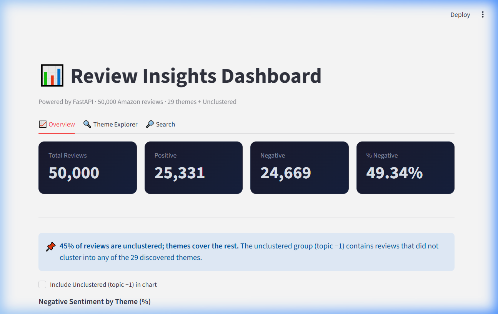
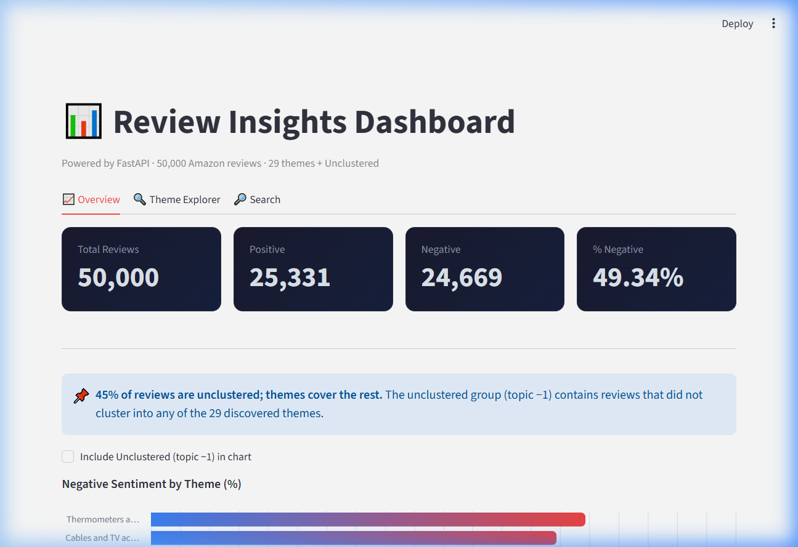
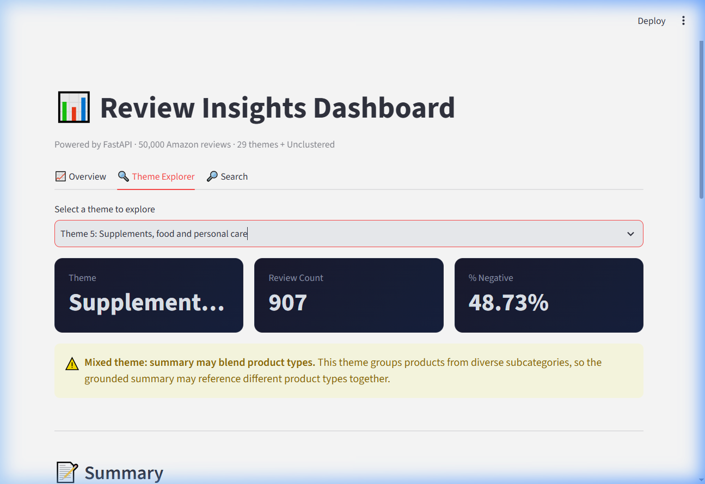
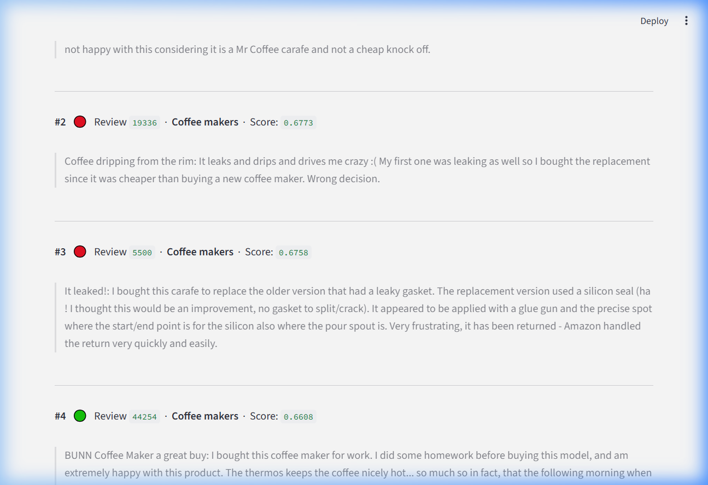
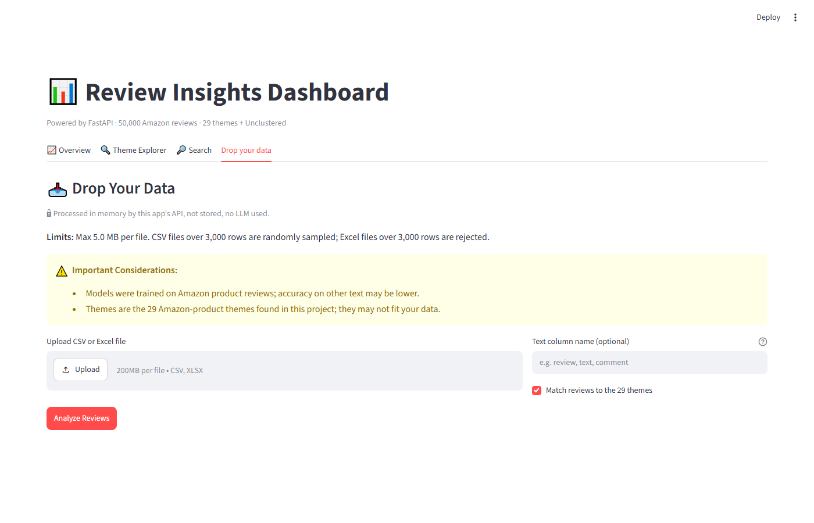
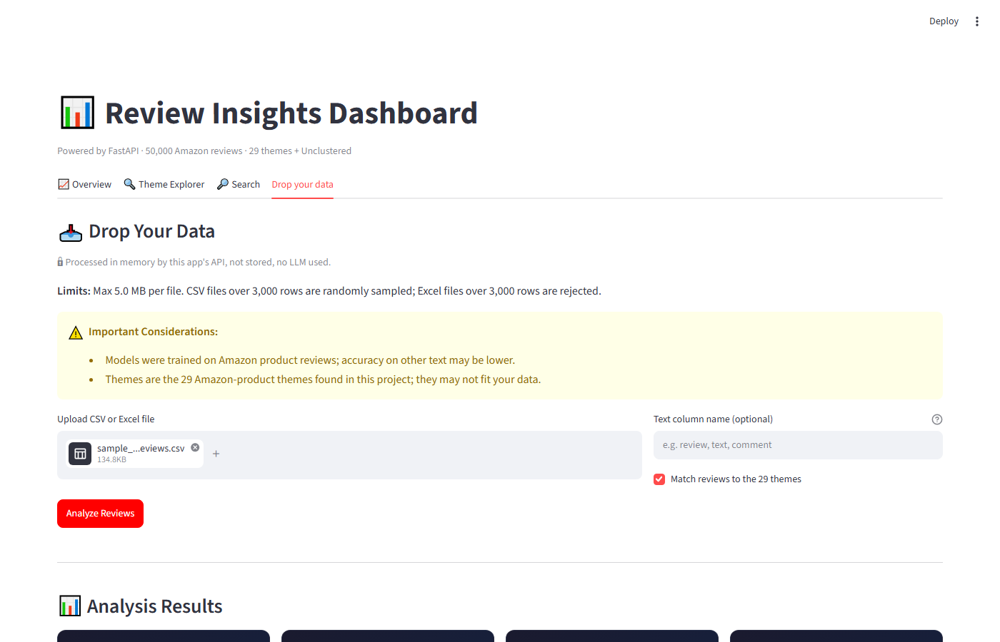
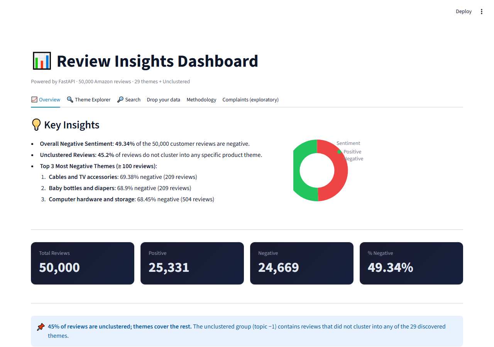
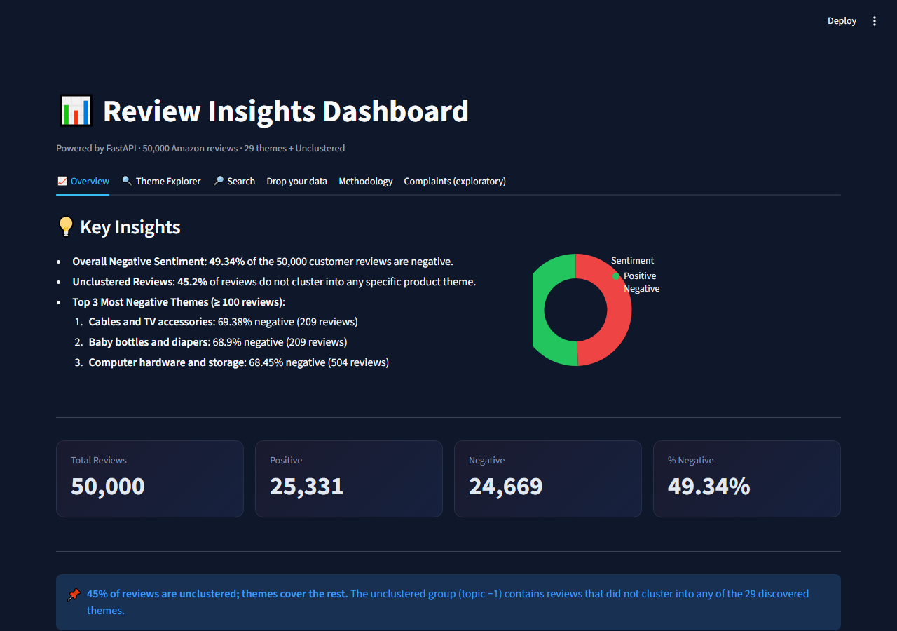
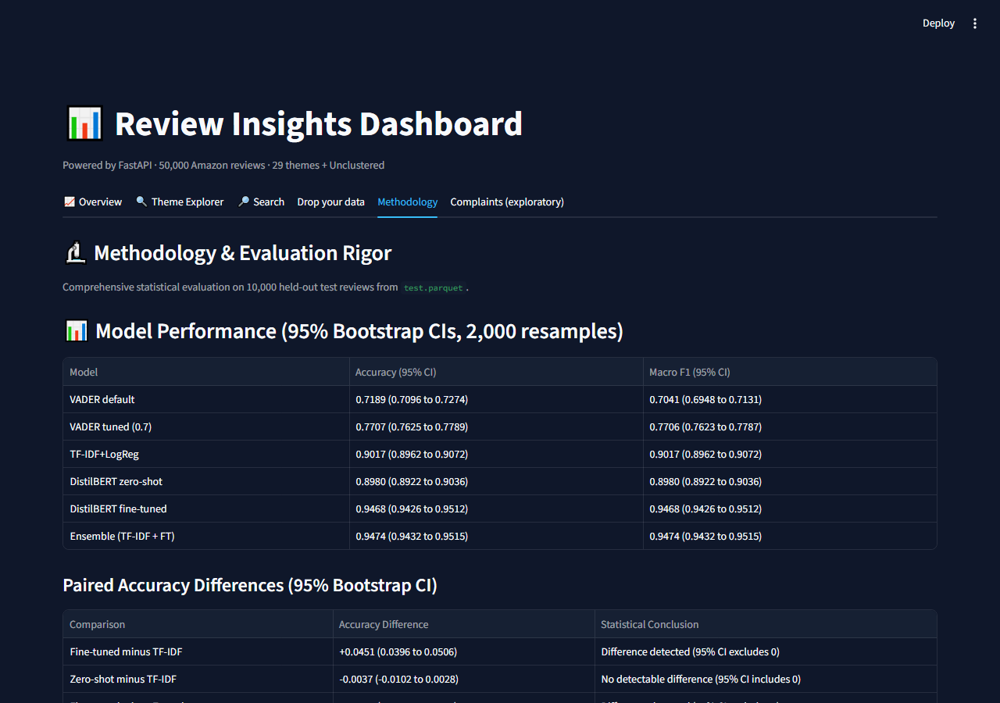
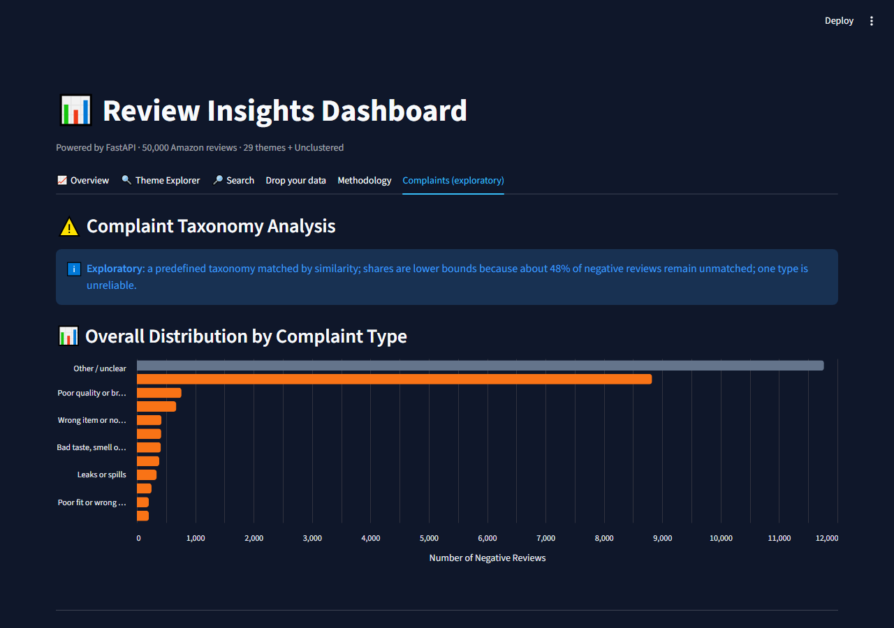

# Nexus — Customer Review Insights Engine

At scale, thousands of customer reviews go unread, leaving critical product flaws, recurring failure modes, and customer delight signals buried in unstructured text. Product and customer experience teams cannot manually sift through tens of thousands of reviews to extract actionable intelligence. **Nexus** addresses this problem on a dataset of **50,000 Amazon product reviews** by providing an end-to-end analytical pipeline: fine-tuned transformer sentiment classification, outlier-aware topic discovery and reduction to **29 core themes**, grounded summaries with automatic citation checks, semantic vector search, relational SQLite storage, and an interactive FastAPI + Streamlit dashboard.

---

## 1. Pipeline Architecture

```mermaid
flowchart TD
    subgraph Ingestion & Preprocessing
        RAW[50,000 Amazon Reviews] --> CLEAN[Text Cleaning & Normalization]
        CLEAN --> EMB[all-MiniLM-L6-v2 Embeddings]
    end

    subgraph Sentiment Classification
        CLEAN --> VADER[VADER Rule Baseline]
        CLEAN --> TFIDF[TF-IDF + Logistic Regression]
        CLEAN --> BERT_ZS[DistilBERT Off-the-Shelf SST-2]
        CLEAN --> BERT_FT[DistilBERT Fine-Tuned]
    end

    subgraph Topic Discovery
        EMB --> LDA[LDA Baseline k=10, 15]
        EMB --> BERTopic_v1[BERTopic v1: 109 Topics + Outliers]
        BERTopic_v1 --> MERGED[Hierarchical Merge: 29 Themes + Unclustered]
    end

    subgraph LLM Intelligence
        MERGED --> LLM_LABEL[LLM Noun-Phrase Theme Labeling]
        MERGED --> LLM_SUM[Grounded Theme Summaries: Praises & Complaints]
        LLM_SUM --> AUTO_CHECK[Automated Checks: Citations & Content Overlap]
    end

    subgraph Storage & Serving
        MERGED & BERT_FT & LLM_SUM --> SQLITE[(insights.db SQLite)]
        EMB & SQLITE --> FASTAPI[FastAPI REST API: /sentiment, /themes, /summary, /search, /dropbox, /review, /similar, /methodology]
        FASTAPI --> STREAMLIT[Streamlit Dashboard: 6 Tabs (Overview, Themes, Search, Drop data, Methodology, Complaints)]
    end
```

---

## 2. Dataset & Limitations

The engine analyzes **50,000 Amazon product reviews** with the following structural limitations:
- **Binary Sentiment Only**: Reviews are categorized strictly as `positive` or `negative`. There is no neutral class to capture hedged or ambivalent reviews.
- **No Dates (No Trends)**: The dataset contains no timestamp or date metadata. Longitudinal trend tracking, time-series aggregations, and temporal spike detection cannot be performed.
- **Star-Derived Label Noise**: Ground truth labels derived from 1–5 star ratings introduce noise (e.g. sarcastic reviews with 5 stars or critical reviews rated 1 star).
- **Mixed Products**: Reviews span diverse product categories (electronics, media, baby products, apparel, personal care) without category partition metadata, leading to composite clusters.

---

## 3. Results

All metrics below are drawn directly from `results/sentiment_comparison.csv`, `results/topic_comparison.csv`, `results/notes.md`, `results/evaluation_upgrade.csv`, `results/mcnemar_tests.csv`, `results/calibration_summary.csv`, and `results/slice_analysis.csv`.

### (a) Sentiment Classification (10,000 Test Reviews)

| Model | Accuracy | Macro F1 | True Negative | False Positive | False Negative | True Positive |
|:---|:---:|:---:|:---:|:---:|:---:|:---:|
| **VADER default** | 0.7189 | 0.7041 | 2,477 | 2,457 | 354 | 4,712 |
| **VADER tuned (0.7)** | 0.7707 | 0.7706 | 3,727 | 1,207 | 1,086 | 3,980 |
| **TF-IDF + LogReg** | 0.9017 | 0.9017 | 4,426 | 508 | 475 | 4,591 |
| **DistilBERT zero-shot** | 0.8980 | 0.8980 | 4,506 | 428 | 592 | 4,474 |
| **DistilBERT fine-tuned** | **0.9468** | **0.9468** | **4,661** | **273** | **259** | **4,807** |

> **Note**: *"DistilBERT zero-shot" refers to an off-the-shelf SST-2 sentiment model, not trained on Amazon data.*

### (b) Topic Modeling & NPMI Coherence

| Method | Topics | Outliers | NPMI |
|:---|:---:|:---:|:---:|
| **LDA (k=10)** | 10 | 0.0% | 0.0420 |
| **LDA (k=15)** | 15 | 0.0% | 0.0305 |
| **BERTopic v1** | 109 | 45.2% | 0.0983 |
| **BERTopic v2** | 248 | 46.7% | 0.0593 |
| **BERTopic v1 (merged 29 themes)** | 29 | 45.2% | 0.0401 |

> **Note on NPMI**: *Coherence depends on topic count and outlier handling; BERTopic NPMI is computed on clustered topics only, excluding the outlier group.*

### (c) Summary & Claim Evaluation

| Metric | Count | Details / Methodological Status |
|:---|:---:|:---|
| **Total claims evaluated** | 168 | Across all 29 themes |
| **Claims not checked** | 6 | Theme 24 (Spanish-language reviews, skipped for English word-overlap) |
| **Out-of-sample citations dropped** | 1 | Review ID `2706` in Theme 2 |
| **Flagged claims (automatic checks)** | 2 | Word-overlap false alarms in Theme 14 and Theme 28 (passed automatic checks upon review) |
| **Claims read by an LLM reviewer** | 18 | 14 supported, 4 partly supported, 0 unsupported |
| **Overview summaries** | 29 | Uncited by design, reported separately from praise and complaint claims |

### (d) Evaluation Upgrade (Bootstrap CIs, McNemar Tests, Calibration, and Slices)

Statistical testing, calibration analysis, and slice evaluations were conducted on the held-out 10,000-review test split (`results/evaluation_upgrade.md`):

#### 1. Bootstrap 95% Confidence Intervals & McNemar Exact Tests
Paired bootstrap resampling (2,000 resamples, seeded random state 42) and exact two-sided binomial McNemar tests on discordant pairs yield:
- **Fine-tuned minus TF-IDF**: **+0.0451** accuracy, 95% CI **0.0396 to 0.0506**, McNemar $b=652$, $c=201$, $p$ about $2.9\text{e-}56$.
- **Off-the-shelf SST-2 model minus TF-IDF**: **-0.0037**, CI **-0.0102 to 0.0028**, $p = 0.288$: no detectable difference.
- **Ensemble (fixed 0.5/0.5) 0.9474 vs fine-tuned 0.9468**, McNemar $p = 0.561$: no detectable gain.
- *Decision rule*: The Methodology conclusions ("difference detected" or "no detectable difference") are generated in code from $p < 0.001$ and from whether the paired bootstrap CI excludes 0.

#### 2. Expected Calibration Error (ECE) & Reliability
Calibration against binary correctness was evaluated using 10 equal-width bins on $[0.5, 1.0]$:
- **ECE**: fine-tuned **0.0295**, SST-2 model **0.0849**, TF-IDF **0.0943**.
- **Fine-tuned accuracy by confidence**: below 0.70 ($n=238$) **0.5546**; 0.70 to 0.90 ($n=401$) **0.6708**; above 0.90 ($n=9,361$) **0.9686**. Band edges fixed in advance, descriptive only.

#### 3. Slice Analysis
- **Length quartiles**: TF-IDF 0.9180, 0.8995, 0.9053, 0.8838; fine-tuned 0.9471, 0.9446, 0.9472, 0.9483. Descriptive only (about 2,500 rows each).
- **Theme slices**: Theme slices have 107 to 4,557 rows; five are marked small n; do not rank themes.
- *Methodological bounds*: Intervals reflect test sampling only; models were trained once; one test set; the ensemble weights were not tuned.

---

## 4. Additional Exploratory Analysis: What Negative Reviews Are About

*(Exploratory, not part of the evaluated pipeline)*

An exploratory investigation was conducted on the subset of **24,669 negative reviews** to determine whether complaint-specific failure modes could be isolated.

### (a) BERTopic on Negative Reviews
Fitting BERTopic directly on negative reviews using precomputed `all-MiniLM-L6-v2` embeddings clustered primarily by product category rather than complaint type:
- **Unmerged (92 topics, 33.38% outliers)**: NPMI **0.0568**
- **Merged (14 themes, 33.38% outliers)**: NPMI **-0.0015**

Because the merged model showed negative coherence and remained split along product lines (e.g., books, movies, audio equipment) rather than failure modes, those 14 themes were not labeled or summarized.

### (b) Predefined Complaint-Type Taxonomy
To categorize complaints across product boundaries, a predefined 11-type taxonomy was constructed with customer-phrased prototype sentences (`config/complaint_types_v2.json`) and embedded using `all-MiniLM-L6-v2`. Using centroid cosine similarity with conservative thresholds ($\text{similarity} \ge 0.30$, $\text{margin} \ge 0.03$), **52.29%** (12,899 / 24,669) of negative reviews matched a complaint type:
- **Disliked the content (plot, writing, acting, music)**: **35.77%** (8,825 reviews), capturing creative dissatisfaction in media categories (books, movies, music).
- **Product-problem types**: **15.50%** (**3,823 reviews**) matched concrete product failure categories:
  - *Poor quality or broke easily*: 764 (3.10%)
  - *Stopped working or defective*: 675 (2.74%)
  - *Wrong item or not as described or pictured*: 422 (1.71%)
  - *Delivery problem: late, never arrived, damaged in shipping*: 417 (1.69%)
  - *Bad taste, smell or skin reaction*: 411 (1.67%)
  - *Hard to install, set up, or not compatible*: 384 (1.56%)
  - *Leaks or spills*: 340 (1.38%)
  - *Poor fit or wrong size*: 205 (0.83%)
  - *Poor customer service, refund or return problems*: 205 (0.83%)
- **Unreliable noise type**: The type *Too loud or noisy* matched 251 reviews (1.02%); its 251 matches (1.02%) are unreliable (about 3 to 4 of 10 sampled looked correct to an LLM reviewer) and remain in the saved v2 file. (Including this type would sum to 4,074 reviews or 16.51%, but **15.5%** is the headline product-problem figure).
- **Other / unclear**: **47.71%** (11,770 reviews) fell below the similarity or margin threshold.

### (c) Exploratory Methodological Limits
- The taxonomy is predefined rather than unsupervised.
- Prototypes were revised once after viewing samples, so sample-based observations are not independent.
- Qualitative assessments relied on a small LLM-reviewed sample (about 10 reviews per type).
- The noise type: its 251 matches (1.02%) are unreliable (about 3 to 4 of 10 sampled looked correct to an LLM reviewer) and remain in the saved v2 file.
- The shares are lower bounds because 47.7% (11,770 reviews) remain "Other / unclear".

---

## 5. Key Findings

1. **Fine-Tuning Gain**: Fine-tuning DistilBERT yielded **94.68% accuracy** and **0.9468 Macro F1**, outperforming the zero-shot baseline (89.80%) by **+4.88 points** and cutting false positives from 428 to 273.
2. **Domain Shift & Linear Baseline**: TF-IDF + Logistic Regression achieved **90.17% accuracy**, proving to be a strong baseline on in-domain Amazon review vocabulary compared to tuned VADER (77.07%).
3. **Coherence vs Human Judgment**: While BERTopic v1 achieved higher NPMI (0.0983) with 109 micro-clusters, 109 topics is overwhelming for decision-makers. Hierarchically merging to 29 themes created human-interpretable product themes; the merged 29-theme NPMI (0.0401) is about the same as LDA k=10 (0.0420), and BERTopic NPMI excludes the 45.2% outliers.
4. **Outlier Reassignment Noise**: Reassigning the 45.2% HDBSCAN outliers via cosine similarity introduced noise; spot-checks revealed clear thematic alignment in only 4 of 8 examined cases per an LLM review.
5. **LLM Labels Needing Correction**: Raw cluster labels required manual refinement: 22 of 29 labels were adjusted (suggested by an LLM reviewer and approved by me), with about 10 fixing real miscategorizations where raw keywords were overly generic or skewed by dominant words.
6. **Themes with Highest Negative Sentiment**: Querying `insights.db` for themes with $\ge 100$ reviews (excluding Unclustered) identified the top 5 pain points:
   - **Cables and TV accessories** (Theme 17): **69.38% negative** (209 reviews)
   - **Baby bottles and diapers** (Theme 18): **68.90% negative** (209 reviews)
   - **Computer hardware and storage** (Theme 9): **68.45% negative** (504 reviews)
   - **Batteries and chargers** (Theme 7): **63.08% negative** (772 reviews)
   - **Headphones and phones** (Theme 8): **61.95% negative** (565 reviews)

---

## 6. Error Analysis

In error analysis across the 10,000-review test split:
- **Both Models Wrong**: 12 of 15 examined reviews where both TF-IDF and fine-tuned DistilBERT failed were determined by an LLM reviewer to be mislabeled in the ground truth or genuinely unresolvable due to conflicting sentiment.
  - *Example (Review 16741)*: Sarcastic review rating 5 stars ("The only thing it gave me was stage 4 metastatic cancer. Overall 5 stars..."), true label `positive`, predicted `negative` by both models.
- **Fine-Tuned Model Failure Modes**: The fine-tuned transformer struggled on:
  1. *Hedged Sentiment*: Reviews containing both strong praise and severe criticism in different paragraphs (e.g. "great pots, lousy lids").
  2. *Non-English Reviews*: French reviews (e.g. Review 17881 "PAS DE VERSION STF: MALGRE VOS INDICATIONS...") misclassified due to English training distribution.

---

## 7. Topic Quality Assessment

Spot-checks conducted across merged themes revealed clear distinctions in topic coherence:
- **Coherent Themes (LLM-reviewed)**:
  - **Theme 0 (Books, 9,231 reviews)**: Highly cohesive book reviews citing reading experience, authors, and writing style.
  - **Theme 13 (Filters, pumps and cleaners, 344 reviews)**: Consistently groups water filters, vacuum cleaners, and humidifiers around mechanical durability.
- **Mixed Themes (LLM-reviewed)**:
  - **Theme 5 (Supplements, food and personal care, 907 reviews)**: Blends protein powders, herbal supplements (Kava Kava), and hair color kits.
  - **Theme 20 (Mixed: Gun cases and backpacks, 159 reviews)**: Blends rifle slings/holsters with laptop backpacks and camera cases.
  - **Theme 28 (Fans, 58 reviews)**: Blends room circulation fans, car fans, ceiling fans, and exhaust components.

---

## 8. Dashboard Screenshots

The interactive dashboard consists of six tabs and contextual safety banners: Overview, Theme Explorer, Search, Drop your data, Methodology, and Complaints (exploratory).

| Overview Tab | Theme Explorer Tab |
|:---:|:---:|
|  |  |
| *Metrics, unclustered notice, and % negative bar chart* | *Selected theme metrics, grounded summary, praises & complaints* |

| Mixed-Theme Caution Banner | Semantic Search Results |
|:---:|:---:|
|  |  |
| *Caution for composite themes (5, 20, 28)* | *Top 10 cosine-similarity results for "coffee maker leaking"* |

| Drop Your Data (Initial State) | Drop Your Data (Scored Results) |
|:---:|:---:|
|  |  |
| *Upload form, file size/row limits, and domain warnings* | *300-row held-out sample KPIs, ratings comparison, and theme chart* |

| Overview Tab (Light Mode) | Overview Tab (Dark Mode) |
|:---:|:---:|
|  |  |
| *Top of the tab: Key Insights card and sentiment distribution donut chart in light theme* | *Top of the tab: Key Insights card and sentiment distribution donut chart in dark theme* |

| Methodology Tab | Complaints Tab (Exploratory) |
|:---:|:---:|
|  |  |
| *Top of the tab: Model performance with 95% bootstrap CIs, paired differences, and McNemar tests* | *Top of the tab: Exploratory complaint taxonomy disclaimer and distribution bar chart* |

---

## 9. Drop Your Data (Score and Match Your Own Reviews)

Nexus provides an upload pipeline and dashboard tab allowing users to score sentiment and match their own customer reviews against the 29 project themes.

### (a) Capabilities & Constraints
- **Supported Formats**: `.csv` (UTF-8-sig or Latin-1) and `.xlsx` (Excel).
- **File Size Cap**: Maximum **5.0 MB** (`5 * 1024 * 1024` bytes). Oversized files return HTTP 413.
- **Row Limits**:
  - CSV files with over 3,000 rows are randomly sampled down to **3,000 rows** using fixed seed `random_state=42`.
  - Excel files exceeding 3,000 data rows are rejected before full loading with HTTP 400.
- **Column Limits**: Maximum **50 columns**.
- **Column Detection**: Automatic heuristic detection identifies the review text column (highest mean string length among non-numeric columns with $\ge 50\%$ non-null entries) and an optional 1–5 star rating column ($\ge 90\%$ values in $[1, 5]$). Users can also specify a column name explicitly via the `text_column` parameter.

### (b) Domain Warnings
Every analysis response and the user interface display two warnings:
1. *"Models were trained on Amazon product reviews; accuracy on other text may be lower."*
2. *"Themes are the 29 Amazon-product themes found in this project; they may not fit your data."*

### (c) Privacy & Data Security
- **In-Memory Processing**: Uploaded reviews are processed entirely in memory in worker threadpools. Uploaded text is never logged, never stored in any database, and never persisted to disk.
- **No LLM Used**: Scoring and matching rely entirely on saved local scikit-learn and sentence-transformer models. No external LLM or cloud API is invoked.
- **Formula Injection Guard**: Any cell beginning with `=`, `+`, `-`, `@`, or tab (`\t`) is escaped with a leading single quote prefix (`'`).
- **PII Placeholders**: All incoming review texts pass through regex masking before scoring and output generation. Raw emails are replaced with `<EMAIL>`, phone numbers with `<PHONE>`, and web links with `<URL>`.
- **Search Command Note**: The file `results/verification_report.md` contains the text of a search command with the string "AIza" and no credential.

### (d) Methodology & Model Mechanics
- **Sentiment Classification**: Predictions use the saved TF-IDF vectorizer and Logistic Regression classifier (`models/tfidf_vectorizer.joblib`, `models/logreg_sentiment.joblib`).
  - *No Neutral Class*: The sentiment model is strictly binary (`positive` / `negative`). Predicted probabilities near 0.5 mean the text has no clear sentiment.
- **Theme Matching**: Computed by calculating cosine similarity between unit-normalized `all-MiniLM-L6-v2` review embeddings and the 29 precomputed unit-normalized theme centroids (excluding outlier topic -1).
  - *Thresholds*: A review is assigned to the top theme if cosine similarity $\ge 0.30$ and the margin over the second-best theme $\ge 0.03$. Otherwise, it is labeled `Unassigned`. These thresholds are untuned.
  - *Amazon Product Specificity*: Because the 29 themes represent specific Amazon product clusters, non-product text is expected to be labeled `Unassigned`.
- **Ground-Truth Rating Evaluation**: When a rating column is detected, reviews with ratings 1–2 are evaluated as negative and 4–5 as positive. Neutral 3-star reviews are ignored.
- **Upload Latency**: Models are loaded lazily upon the first request to `/dropbox/analyze`. Measured values on this machine: first call **10.17 s** and warm call **6.06 s** for 300 rows, about **0.02 s per row** for theme matching (so a 3,000-row file would take about a minute; marked as an estimate).
- **Docker Image Notice**: Docker images predate this feature and were not rebuilt.

### (e) Automatic Acceptance Check Results
Detailed acceptance test logs and profiling are recorded in [`results/dropbox_notes.md`](results/dropbox_notes.md).
- **Held-Out Test Sample Check** (from `data/processed/test.parquet`, not used for training):
  - **300 rows** (`random_state=3`): **0.890 sentiment accuracy** (**89.00%**), **0.8887 macro F1**, rows used = 300.
  - **1,000 rows** (`random_state=4`): **0.887 sentiment accuracy** (**88.70%**), **0.8867 macro F1**, rows used = 1,000.
  - *Evaluation Scope*: Sentiment accuracy 0.890 (300 rows) and 0.887 (1,000 rows) were checked on held-out rows from `test.parquet`, sampled in an automatic acceptance script, and the official model accuracy remains **0.9017** on the full 10,000-row test set; these two checks only confirm the feature runs end to end.
  - *Theme Assignment Rate Note*: The 87.0% theme-assignment rate on those rows is NOT held out (the theme centroids were built from all 50,000 reviews) and is not an evaluation.
- **Not-Amazon Text Check** (40 non-product texts written by the acceptance script: tweets, support messages, news comments):
  - HTTP 200, both warnings present, no crash.
  - Sentiment split: 29 positive (72.5%) / 11 negative (27.5%).
  - Share `Unassigned`: **80%** (32 / 40).
  - Share with probability $< 0.65$: **67.5%** (27 / 40).
  - *Domain Shift Illustration*: On these 40 non-product texts written by the acceptance script, 80% were Unassigned and 67.5% had probability below 0.65. At least two of the five printed examples had a wrong sentiment label (Row 2 prompt utility bill resolution mislabeled negative; Row 3 stressful doubled commute mislabeled positive) and one had a spurious theme match (Row 2 utility support matched to "Batteries and chargers"). This illustrates the domain shift warning; it is not a measured accuracy because the texts were written by the script and have no ground truth.

---

## 10. New Explore REST Endpoints & Analytical Tabs

### (a) Explore REST Endpoints
- `GET /review/{review_id}`: Retrieves single review details (`review_id`, `text`, `sentiment_true`, `theme_id`, `theme_label`) by non-negative integer ID directly from `insights.db` in read-only mode (`mode=ro`). Returns HTTP 404 for unknown review IDs, and HTTP 422 with structured JSON error details for negative or non-integer inputs without tracebacks.
- `GET /similar/{review_id}?k=10`: Returns top-$k$ nearest topical neighbors ($1 \le k \le 20$, default $k=10$) using cosine similarity across precomputed unit-normalized embeddings via a memory-mapped numpy array under a concurrency lock. The query review itself is excluded from returned neighbors. Each neighbor includes `review_id`, similarity `score`, truncated `text` (300 characters), `sentiment_true`, and `theme_label`.
  - *Topical note*: The "Reviews about the same subject" results are topical, not about sentiment (the query review for `/similar/0` was negative and its three nearest neighbours were positive).
- `GET /methodology`: Serves structured JSON for whitelisted CSV files in `results/` (`sentiment_comparison.csv`, `topic_comparison.csv`, `evaluation_upgrade.csv`, `mcnemar_tests.csv`, `calibration.csv`, `calibration_summary.csv`, `slice_analysis.csv`, `complaint_type_counts_v2.csv`, `complaint_by_theme_v2.csv`), sanitizing `NaN` and `inf` values to standard JSON `null`.

### (b) Methodology and Complaints Tabs
- **Methodology Tab**: Presents statistical evaluation rigor on 10,000 held-out test reviews:
  - Model performance table with 95% bootstrap confidence intervals (2,000 resamples).
  - Paired accuracy difference table and McNemar exact discordant tests. Statistical conclusions ("difference detected" or "no detectable difference") are generated in code from $p < 0.001$ and from whether the paired bootstrap CI excludes 0.
  - Interactive reliability diagram with Expected Calibration Error (ECE) summary table and fine-tuned accuracy by confidence band.
  - Slice analysis table across review length quartiles, confidence bands, and product theme slices (with small-$n$ flags).
  - Topic modeling comparison table and verbatim methodological limits.
- **Complaints Tab (Exploratory)**: Explores failure modes across negative reviews using a predefined 11-category complaint taxonomy:
  - Overall distribution bar chart of negative reviews by complaint type.
  - Heat map of complaint type percentages across product themes having at least 100 negative reviews (20 product themes plus the Unclustered group).
  - Full interactive complaint breakdown data table.

---

## 11. How to Run

### (a) Repository Structure

```
review-insights/
├── .streamlit/
│   └── config.toml                   # Light and dark theme configurations
├── app/
│   └── dashboard.py                  # Streamlit dashboard (6 tabs)
├── config/
│   ├── complaint_types.json          # Initial complaint prototypes
│   └── complaint_types_v2.json       # 11 complaint types with prototype sentences
├── notebooks/                        # Numbered research notebooks (01 to 10)
├── results/                          # Evaluation metrics, reports, and screenshots
│   ├── calibration.csv               # Calibration bins and running totals
│   ├── calibration.png               # Reliability diagram
│   ├── calibration_summary.csv       # Expected Calibration Error summary
│   ├── dropbox_notes.md              # Acceptance checks and cold-start profiling
│   ├── evaluation_upgrade.csv        # Bootstrap 95% CIs and paired differences
│   ├── evaluation_upgrade.md         # Comprehensive evaluation upgrade documentation
│   ├── mcnemar_tests.csv             # McNemar exact tests on discordant pairs
│   ├── slice_analysis.csv            # Length, confidence, and theme slice analysis
│   └── screenshots/                  # Dashboard PNG captures (01 to 09)
├── scripts/
│   ├── acceptance_dropbox.py         # Automated end-to-end acceptance test script
│   └── evaluation_upgrade.py         # Evaluation upgrade generation script
├── src/
│   ├── api/
│   │   ├── main.py                   # FastAPI REST backend
│   │   ├── dropbox_router.py         # Endpoints: GET /dropbox/limits, POST /dropbox/analyze
│   │   └── explore_router.py         # Endpoints: /review/{id}, /similar/{id}, /methodology
│   ├── dropbox/                      # Core Drop-your-data processing pipeline
│   │   ├── cleaning.py               # Text cleaning and deduplication
│   │   ├── errors.py                 # Structured exception classes
│   │   ├── loader.py                 # CSV/XLSX loader and column detector
│   │   ├── pii.py                    # Regex PII scrubbing
│   │   ├── pipeline.py               # End-to-end analyze pipeline
│   │   ├── scorer.py                 # TF-IDF + Logistic Regression sentiment scorer
│   │   └── themes.py                 # Centroid-based 29-theme matcher
│   ├── cleaning.py                   # Raw data cleaning utilities
│   ├── complaints.py                 # BERTopic clustering on negative reviews
│   ├── complaint_types.py            # Predefined complaint taxonomy matcher
│   ├── db.py                         # SQLite database builder
│   ├── llm.py                        # LLM wrapper with caching
│   ├── sentiment.py                  # Sentiment metrics computation
│   ├── summaries.py                  # Grounded summary generation & checks
│   └── topics.py                     # Topic modeling and coherence utilities
└── tests/                            # Pytest test suite (44 tests)
    ├── conftest.py                   # Test configuration
    ├── test_api.py                   # Tests for core API endpoints (7 tests)
    ├── test_dashboard.py             # Streamlit AppTest suite (2 tests)
    ├── test_dashboard_v12.py         # Streamlit AppTest for v1.2 components (1 test)
    ├── test_dropbox_api.py           # Integration tests for /dropbox endpoints (15 tests)
    ├── test_explore_api.py           # Integration tests for explore endpoints (7 tests)
    └── dropbox/
        └── test_dropbox.py           # Unit tests for dropbox package (12 tests)
```

### (b) Local Environment Setup

Requires Python 3.11:

```bash
# Clone and enter directory
git clone https://github.com/Hecker-12/Nexus---Review_Insights.git
cd Nexus---Review_Insights

# Create and activate virtual environment
python -m venv .venv311
# Windows:
.venv311\Scripts\activate
# Linux/macOS:
source .venv311/bin/activate

# Install dependencies
pip install -r requirements.txt
```

### (c) Data Regeneration Order

Note: `data/` and `models/` are excluded from version control. To regenerate all processed artifacts:
1. `notebooks/01_cleaning.ipynb` — Clean and tokenize raw reviews to `data/processed/reviews_clean.parquet`.
2. `notebooks/02_sentiment.ipynb` & `03_distilbert_ft.ipynb` — Evaluate baselines and fine-tune DistilBERT, outputting `data/processed/test_preds.parquet`.
3. `notebooks/04_embeddings.ipynb` — Generate 384-dim unit-normalized `all-MiniLM-L6-v2` embeddings (`data/processed/embeddings.npy`).
4. `notebooks/05_lda.ipynb` & `06_bertopic.ipynb` — Train LDA baselines and BERTopic v1/v2 models.
5. `notebooks/08_bertopic.ipynb` — Execute hierarchical reduction to 29 themes (`data/processed/topics_v1_merged.parquet`).
6. `src/summaries.py` — Generate grounded summaries via Gemini, enforce automated validation checks, and save `data/processed/theme_summaries.json`.
7. `src/db.py` — Populate relational tables in `data/processed/insights.db`.

> **Environment Variables**: Set `${GEMINI_API_KEY}` and optionally `LLM_MODEL=gemini-1.5-flash` in `.env` before running LLM generation scripts.

### (d) Running API & Dashboard

```bash
# Terminal 1: Start FastAPI REST Backend
uvicorn src.api.main:app --host 127.0.0.1 --port 8000 --reload

# Terminal 2: Start Streamlit Dashboard
streamlit run app/dashboard.py
```

Access the dashboard at `http://localhost:8501` and interactive Swagger docs at `http://localhost:8000/docs`. The dashboard includes six tabs:
1. **Overview**: Overall KPIs, key insights card, sentiment distribution donut chart, % negative bar chart, and full theme table.
2. **Theme Explorer**: Deep dive into individual themes with praises, complaints, cited review IDs, and cited review viewer (`/review/{id}`).
3. **Search**: Semantic vector search across all 50,000 reviews using cosine similarity, with topical nearest neighbors (`/similar/{id}`).
4. **Drop your data**: Upload CSV or Excel files for in-memory scoring, theme matching, and CSV export.
5. **Methodology**: Statistical evaluation rigor, bootstrap 95% CIs, McNemar exact tests, calibration curves, slice analysis, and methodological limits.
6. **Complaints (exploratory)**: Complaint taxonomy frequencies, theme heat map ($\ge 100$ negative reviews), and full breakdown table.

### (e) Running with Docker Compose

```bash
docker compose up
```
*Note: Tested at submission time using images built earlier: docker compose up -d --no-build started both containers; GET /sentiment and GET /search returned 200 and the Streamlit page responded with 200 (page shell only). The images were not rebuilt and do not include the Drop-your-data feature.*

---

## 12. Limitations & Future Roadmap

### Known Limitations
1. **Binary Classification**: Neutral or mixed customer sentiment is forced into binary buckets (`positive` / `negative`).
2. **Missing Dates**: The dataset lacks timestamp attributes, precluding velocity, trend, or seasonality tracking.
3. **45.2% Unclustered Reviews in Topic Discovery**: HDBSCAN leaves 22,623 reviews in topic `-1` to preserve cluster purity.
4. **Weakly Supervised Star Labels**: Ground truth labels carry natural reviewer bias and sarcasm.
5. **Predefined Complaint Taxonomy**: Prototype-similarity matching leaves 47.71% of negative reviews unassigned in "Other / unclear".

### Future Work
- **New Topic Discovery on Uploaded Data**: Performing unsupervised clustering on uploaded data that falls outside the 29 existing product themes.
- **Background Processing for Large Files**: Asynchronous worker queue processing for larger batches beyond the 3,000-row limit.
- **Complaint Summaries**: Generating grounded, citation-backed summaries specifically for each complaint category.
- **Topics on Negative Reviews with a Better Method**: Exploring hierarchical clustering with adaptive density estimation or contrastive clustering to extract granular failure modes from negative reviews without product-category entanglement.
- **Dated Dataset for Trends**: Augmenting with timestamped e-commerce review streams to detect defect spikes and emerging failure trends over time.
- **Human Review of Summaries**: Conducting human review of generated claims and praise/complaint summaries alongside automated checks.

---

## 13. Quality Control: Who Checked What

| Component / Task | Automatic Checks | LLM Reviewer | Human (me) |
|:---|:---|:---|:---|
| **Sentiment Model Evaluation** | Accuracy, macro F1, confusion matrices on the held-out 10,000-review test set | Error samples | Not done |
| **Evaluation Upgrade** | 2,000 bootstrap resamples (95% CIs), McNemar exact discordant tests, ECE calculation, slice analysis | None | Not done |
| **Grounded Summaries** | Citation parsing (1 out-of-sample ID dropped), word overlap (2 flagged, both false alarms), 6 not checked | 18 claims (14 supported, 4 partly, 0 unsupported) | Not done |
| **Theme Labels** | None | Gemini drafted labels, Claude suggested corrections (22 of 29 changed, about 10 fixing real errors), I approved them | Approval only |
| **Topic Quality** | None | Spot-check of 5 themes | Not done |
| **Complaint Taxonomy** | Thresholds | About 10 reviews per type | Not done |
| **API Endpoints** | 14 passing tests (`tests/test_api.py` and `tests/test_explore_api.py`) | None | Not done |
| **Drop box** | 27 passing tests (unit & integration) + acceptance script (held-out accuracy: 89.00% on 300 rows, 88.70% on 1,000 rows) | None | Not done |
| **Dashboard UI** | 3 passing AppTest tests (`tests/test_dashboard.py`, `tests/test_dashboard_v12.py`) | None | Not done |

---

## 14. Methods & Transparency Note

- **LLM Used**: Grounded summaries were generated using a Gemini Flash-Lite model (exact version not recorded; current setting: gemini-2.5-flash-lite), temperature 0.0, and stratified sample prompts.
- **LLM Reviewer**: Claim, error-analysis, label and topic reviews marked 'LLM reviewer' were done by Claude (Anthropic) in a chat session, from excerpts I pasted. They were not done by a human and not by automated Gemini prompts.
- Not done: manual human review of sampled claims, misclassified reviews, and topic coherence.